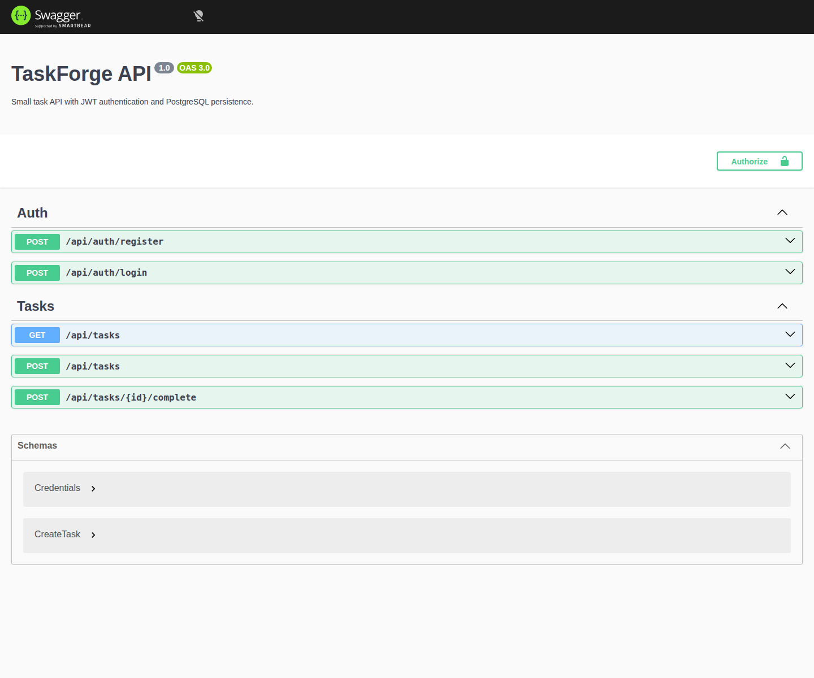

# TaskForge API


TaskForge is a NestJS API for authenticated task management, with a small fictional production-order workflow used to demonstrate state validation, audit history, and concurrent-update handling.

It is also the shared backend for two frontend implementations:
- [WorkBoard](https://github.com/imenabidimen/workboard-vue) — Vue 3 + TypeScript task workflow.
- [ClientHub](https://github.com/imenabidimen/clienthub-react) — React + TypeScript deliverables-oriented view.

[Foody](https://github.com/imenabidimen/Abid_Araari_Trabelsi_lglsi2c) is an earlier university group project.

## Stack

- NestJS and TypeScript
- PostgreSQL with Prisma migrations
- JWT bearer authentication and bcrypt password hashing
- Request validation with class-validator / class-transformer
- Swagger/OpenAPI
- Jest and GitHub Actions

## API overview

| Method | Endpoint | Purpose |
| --- | --- | --- |
| POST | `/api/auth/register` | Create an account |
| POST | `/api/auth/login` | Sign in and receive a token |
| GET | `/api/health/live` | Check that the process responds |
| GET | `/api/health/ready` | Check database readiness |
| GET | `/api/tasks` | List the signed-in user's tasks |
| POST | `/api/tasks` | Create a task |
| POST | `/api/tasks/:id/complete` | Complete a task |
| GET | `/api/production-orders` | List the signed-in user's production orders and history |
| POST | `/api/production-orders` | Create a production order |
| PATCH | `/api/production-orders/:id/status` | Apply an allowed status transition |

Task listing uses bounded offset pagination: `limit` is 1–100 (default 20), and `offset` is non-negative (default 0). Task and production-order access is scoped to the authenticated account; the API does not trust an owner ID supplied by the client.

## Production-order case study

The production-order workflow is a fictional portfolio example, not a representation of an employer's proprietary system.

```text
CREATED -> RELEASED -> RUNNING -> COMPLETED
    |          |          |
    +----------+----------+-> CANCELLED (only before RUNNING)
```

The API rejects skipped or terminal-state transitions, records the actor, timestamp and optional reason for successful transitions, and uses a version check to reject stale concurrent updates. State changes and their audit events are written in the same database transaction.

See [the workflow notes](docs/production-order-workflow.md) and [ADR 0002](docs/adr/0002-production-order-state-transitions.md) for the constraints and trade-offs.

## Run locally

Requirements: Node.js 22+, Docker, and npm.

```bash
docker compose up -d postgres
cp .env.example .env
# Set JWT_SECRET to a random value of at least 32 UTF-8 bytes.
npm ci
npm run prisma:generate
npx prisma migrate deploy
npm run start:dev
```

Swagger UI: http://localhost:3000/docs

The example database credentials are for local development only. Do not reuse them or a development JWT secret in a deployed environment.

## Source layout

```text
src/
  app.module.ts
  main.ts
  auth.controller.ts
  auth.service.ts
  auth.guard.ts
  health.controller.ts
  request-logging.middleware.ts
  tasks.controller.ts
  tasks.service.ts
  production-orders.controller.ts
  production-orders.service.ts
  prisma.module.ts
  prisma.service.ts
prisma/
  schema.prisma
  migrations/
test/
  unit and database integration tests
```

## Verification

GitHub Actions installs dependencies with `npm ci`, generates the Prisma client, applies migrations to PostgreSQL, runs type-checking and tests, builds the application, starts the API, and captures the Swagger UI in a browser. The screenshot is uploaded as a workflow artifact.



## Engineering notes

- [Architecture and current boundaries](docs/architecture.md)
- [ADR 0001: modular monolith](docs/adr/0001-modular-monolith.md)
- [ADR 0002: production-order state transitions](docs/adr/0002-production-order-state-transitions.md)
- [Production-order workflow](docs/production-order-workflow.md)
- [Operational runbook](docs/operations/runbook.md)
- [Evidence-driven roadmap](docs/roadmap.md)

This project demonstrates a deliberately limited API rather than claiming to be a fully deployed production platform. Deployment, measured load results, and a monitoring stack are not claimed until implemented and verified.
