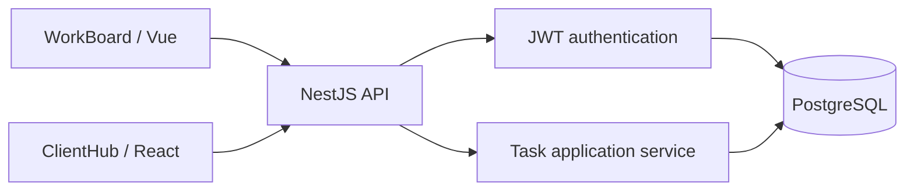
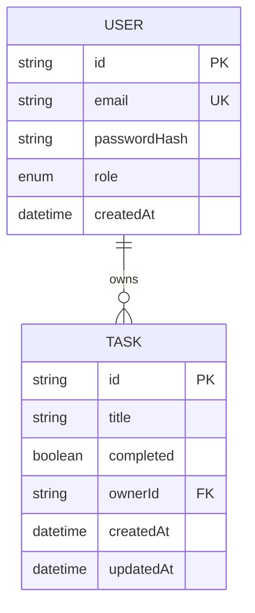

# TaskForge architecture

## Purpose and scope

TaskForge is a deliberately small authenticated task API. WorkBoard (Vue) and ClientHub (React) are separate clients of the same API. PostgreSQL is the source of truth; neither frontend owns authorization or persistence.

This document distinguishes implemented behavior from future work. The current application is a modular NestJS application, not a distributed system.

## System context

## Current request path

1. A client submits credentials to the authentication endpoint.
2. The API validates input and verifies the password hash.
3. The API issues a short-lived JWT.
4. Authenticated task requests send the token as a Bearer token.
5. The guard verifies the token and the task service scopes reads and writes to the authenticated user's ID.
6. Prisma sends parameterized database operations to PostgreSQL.

The client must not supply an authoritative owner ID. A resource outside the authenticated user's scope should behave as not found rather than revealing another user's resource.

## Code boundaries

- **Controllers** translate HTTP requests into application calls and return HTTP responses.
- **AuthService / AuthGuard** own credential verification and token validation.
- **TasksService** owns task operations and ownership scoping.
- **PrismaService** is the database access boundary.
- **Prisma migrations** version schema changes and are applied by CI before tests/build checks.

These boundaries are intentionally lightweight. The project does not yet have a separate domain layer, message broker, background worker, cache, or independent deployable services.

## Data model

The compound index on `Task(ownerId, completed)` supports the common per-user task list and status filtering pattern. This is a design hypothesis, not a performance claim; validate it against query plans and representative data before adding further indexes.

## Reliability and security properties today

- DTO validation runs at the HTTP boundary.
- JWTs are short-lived (15 minutes in the current configuration).
- Task ownership comes from the verified identity.
- Database schema changes are versioned with Prisma migrations.
- CI runs type-checking, tests, migrations against PostgreSQL, a production build, and a browser check of Swagger.

## Known gaps

These are intentionally not described as implemented capabilities:

- Liveness and database readiness endpoints are implemented; they are basic probes, not a full monitoring system.
- Structured HTTP request logs include a request ID, method, path, status code, and duration. Query strings are excluded from the logged path; caller-provided IDs are restricted to a safe character set.
- No metrics or distributed tracing yet.
- No deployment workflow or public hosted demo documented here.
- No explicit rate limiting or refresh-token/session revocation flow.
- No measured load-test baseline or production SLO.
- The role field exists in the schema, but a complete role/permission policy is not a current feature.
- No optimistic concurrency/version field for concurrent task edits.

## Evolution approach

Prefer the smallest change that solves a demonstrated requirement. Before introducing a queue, cache, microservice, or more complex authorization model, write down the failure mode or workload that requires it and record the decision in an ADR. See [the operational runbook](operations/runbook.md) and [the roadmap](roadmap.md).
