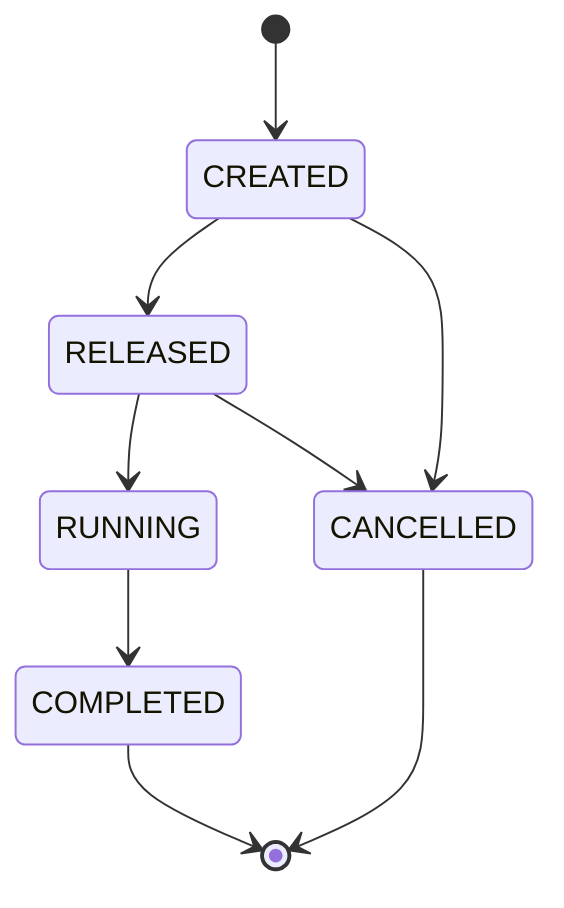

# Production-order workflow (fictional case study)

This is a small, fictional manufacturing-execution domain used to demonstrate state invariants, ownership, audit history, and concurrent-update handling. It is not based on or intended to reproduce any employer's internal system.

## State model



| Current state | Allowed next state | Meaning |
| --- | --- | --- |
| `CREATED` | `RELEASED` | Order is approved to start |
| `CREATED` | `CANCELLED` | Order is cancelled before release |
| `RELEASED` | `RUNNING` | Execution has started |
| `RELEASED` | `CANCELLED` | Order is cancelled before execution |
| `RUNNING` | `COMPLETED` | Execution is complete |
| `COMPLETED`, `CANCELLED` | none | Terminal states |

## Invariants

- Order numbers are unique at the database level, including concurrent creates.
- The authenticated user ID is the owner; clients cannot provide a different owner ID.
- Invalid or skipped transitions return a conflict response.
- Every accepted transition writes the order update and an audit event in one database transaction.
- The event records previous state, next state, actor, timestamp, and optional reason.
- The update compares the current status and version. A concurrent request that uses stale state is rejected; it must reload before retrying.
- Listing returns only orders owned by the authenticated user.

## Try it

Open Swagger UI at `/docs` after starting the API, authenticate with a bearer token, then use the `production-orders` endpoints.

Create an order:

```http
POST /api/production-orders
Authorization: Bearer <access-token>
Content-Type: application/json

{
  "orderNumber": "PO-2026-001",
  "materialCode": "MAT-42",
  "plannedQuantity": 250
}
```

Release it (replace the ID with the returned order ID):

```http
PATCH /api/production-orders/<order-id>/status
Authorization: Bearer <access-token>
Content-Type: application/json

{
  "status": "RELEASED",
  "reason": "Material and schedule verified"
}
```

Trying to move directly from `CREATED` to `COMPLETED` should return a conflict. The order list includes the recorded transition events.

## What this does not claim

This is a deliberately small domain slice. It does not yet model equipment capacity, material reservations, external system integration, message delivery, production reporting, or a deployment/monitoring environment. Those should be added only with tests and a clear business requirement.
